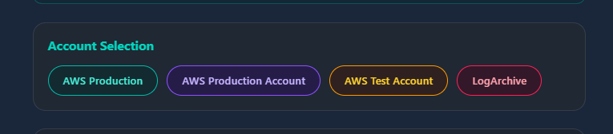
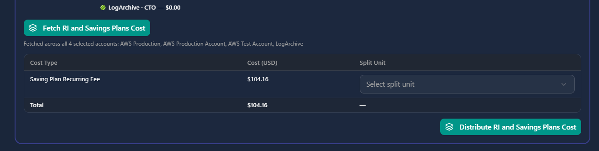
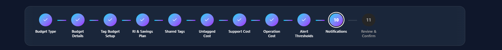
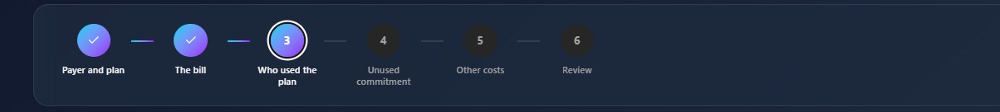
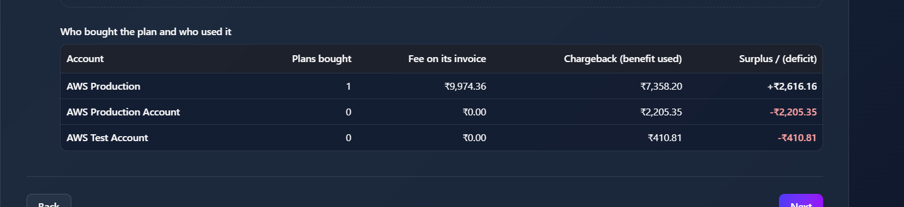
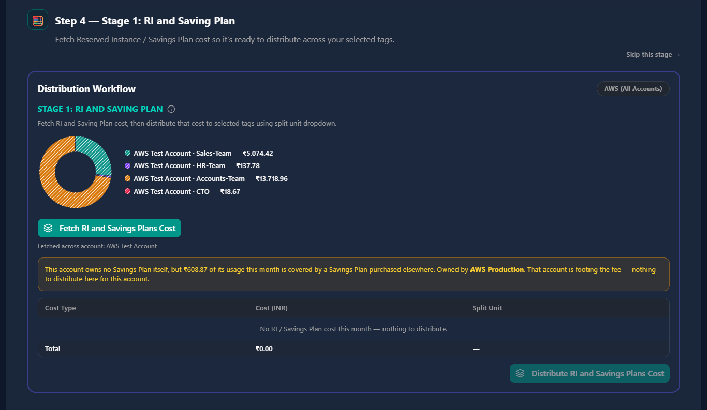
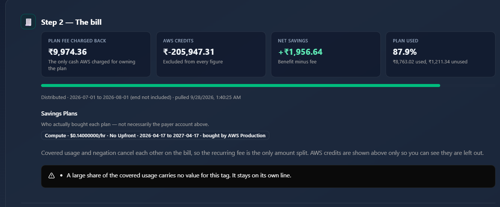
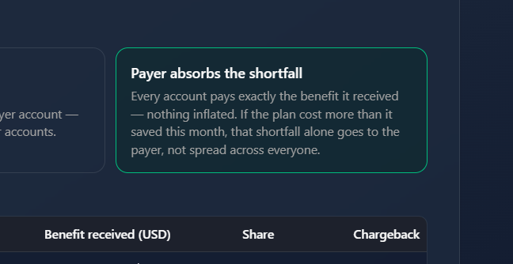
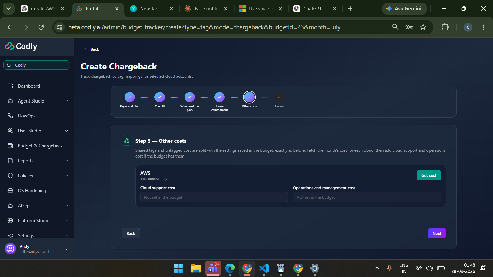

add a select all acount option in this place

should get account wise saving account here to see which account is allocated howmuch saving plan

note that mostly the payer account have this information that which account have how much of saving plan so try fetching it from there and also note that if we are getting cost from the - do not get fucking  all cost in payer account - show it in account it actaully belong

when i click on this we should be going on that pages so make that too - if the page is field then only boyh in budget abd chaargeback

givw user the option to fetch all the saving plan that this account consume or tag consumw so that weee are able to distributee the cosst in compustion of sp manner

 mostly here we fwtch the sp accordingly accouny but still test it and see that aall sp is not assign to payer account 

same here

 This option get enables when there is loss If there is profit disruption is disabled

* [ ]  This options enable only when We have to now let things but that's not the point for now the point is that before this other cost we have to split the tag So like the common tax the same thing that we have in budget we have to bring that here too also we have to See that at the end we show APDF report like we have for W Management with all All the things that have been generated in charge back also I have said you before that the chargeback should have Like once a chargeback is generated the budget should be updated according to chargeback Sugar tag level budget will be upgraded according to the chargeback Also beside all this We have to see that the pdf have the branding Page first and All the different things inside of the chargeback After that and the layout should be nice I will be looking into the pdf Also in charge back I want few options like First option Apply it as budget So the distribution common tag will be applied as budget And the split will be created according to the budget the saving plan will be distributed according to the budget Similarly and also we will have another option that is copy Budget pattern sorry copy charge back pattern For this month from last month So you can train this sentence nicely and this sentence That what I want to do so it is like I want that the last month budget should be updated according to this month Sorry not budget the chargeback Now beside I want you to make sure that We have the option for account level Chargeback 2 Now I know I'm asking you too much but I want this thing to be implemented And I want you to test it also see that the account level charge bag is working fine It will have all similar things like tag And also we have to fetch and distribute saving plans In account level things too so accountable budget Do this to implementation please
